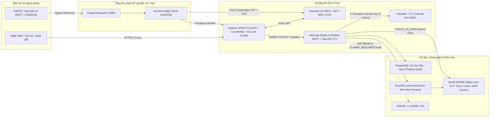

# Làng Nghề Số (`langnghe-dx-os`)

[](LICENSE)
[](https://github.com/dochicongg-lang/langnghe-dx-os/actions/workflows/ci.yml)
[](openapi.yaml)
[](services/trace-api/gs1.js)
[](THIRD-PARTY-NOTICES.md)

Nền tảng chuyển đổi số **mã nguồn mở thuần túy (100% Open-Core / Proof of Freedom)** cho hệ sinh thái **làng nghề và hồ sơ OCOP**, xây dựng theo kiến trúc **DX-OS 3 tầng** kết hợp **Zero-Trust API Gateway**, **chuẩn truy xuất TCVN 13274 / GS1 Digital Link & EPCIS 2.0**, **quy trình BPMN 2.0 trên Flowable**, và **chống gian lận dữ liệu IoT bằng chữ ký số Ed25519 + phân tích đường cong nhiệt (Heat Work / DTW)**.

---

## 1. Mô hình triển khai Multi-tenant (Cấp Tỉnh / Liên minh HTX)

Hệ thống được thiết kế để triển khai **một cụm hạ tầng dùng chung ở cấp Tỉnh hoặc Liên minh Hợp tác xã (HTX)**, phục vụ đồng thời nhiều HTX và nhiều ngành nghề khác nhau mà vẫn cách ly nghiêm ngặt dữ liệu:

- **Cách ly theo Hợp tác xã (`coop` claim trong JWT Keycloak):** Mọi truy vấn sản phẩm, hồ sơ OCOP, tài liệu đính kèm và dữ liệu cảm biến IoT (`/api/trace/v1/iot/readings`) đều bắt buộc đi qua **Apache APISIX + Keycloak JWT**, đối chiếu vai trò từ [`config/access.json`](config/access.json) và lọc theo đúng `coop` của người dùng (`htx-demo`, `htx-lua`, ...).
- **Mở rộng ngành nghề bằng cấu hình động (Zero-FE-Code-Change):** Danh mục ngành nghề, công đoạn sản xuất và ngưỡng giám sát lò/bể nằm hoàn toàn trong [`config/sectors.json`](config/sectors.json) và [`config/kiln-profiles.json`](config/kiln-profiles.json) (được kiểm tra bởi [`schemas/`](schemas/)). Thêm ngành nghề thứ 3 vào JSON là giao diện giám sát, đường cong chuẩn và quy trình OCOP tự động hiển thị mà **không cần sửa mã Frontend**.

---

## 2. Khởi chạy nhanh 2 chế độ (Lite vs Full)

Cần: **Docker Engine / Docker Compose v2**, **Node.js 20+** (khuyến nghị 22), **Git Bash** (trên Windows).

### So sánh 2 chế độ triển khai

| Chế độ | Lệnh khởi chạy | Dịch vụ chạy | RAM cấu hình / mục tiêu | Mục đích sử dụng |
|---|---|---|---|---|
| **Mặc định (Lite)** | `bash scripts/upgrade.sh` *(hoặc `docker compose up -d`)* | **8 dịch vụ chạy nền** (`postgres`, `minio`, `keycloak`, `flowable`, `etcd`, `apisix`, `trace-api`, `frontend`) + `minio-init` | Giới hạn cấu hình ~1,6–1,9 GB RAM *(đo thực tế trên máy chạy Docker bằng `docker stats --no-stream`)* | Demo trên laptop 8–16 GB RAM, phát triển & chấm thi nhanh. `CLAMAV_REQUIRED=false` ghi nhận `avStatus: "skipped-lite-profile"`. |
| **Đầy đủ (Full)** | `CLAMAV_REQUIRED=true docker compose --profile full up -d --build` | **Tất cả 12 dịch vụ** (thêm `clamav`, `mosquitto`, `iot-mqtt-bridge`, `caddy`) | ~3,2–3,8 GB RAM *(ClamAV 1.4 nạp CSDL mẫu virus)* | Triển khai đầy đủ: quét mã độc bắt buộc, thu nhận IoT MQTT + Ed25519 và Caddy HTTPS reverse proxy. |

> Có thể bật lẻ từng nhóm dịch vụ bằng `--profile iot` (chỉ thêm `mosquitto` + `iot-mqtt-bridge`) hoặc `--profile prod` (thêm `caddy`). Trước khi đưa ra Internet thật, đặt `CLAMAV_REQUIRED=true`, dùng MinIO Object Lock `COMPLIANCE` và kiểm tra bằng `node scripts/prod-check.js`.

### Nạp dữ liệu mẫu & Tài khoản trình diễn

```bash
bash scripts/upgrade.sh       # Dựng hạ tầng Lite mặc định, cấu hình Keycloak/APISIX/MinIO/Flowable
node scripts/seed-demo.js     # Nạp dữ liệu mẫu gốm & lụa (an toàn khi chạy lặp lại)
```

- **Tài khoản thử** *(chỉ dùng cho môi trường dev/demo; mật khẩu trùng tên đăng nhập; đổi hoặc xóa trước khi vận hành thật)*:

| Tài khoản | Vai trò | HTX (`coop`) | Ghi chú |
|---|---|---|---|
| `hoa` | Nghệ nhân (`producer`) | `htx-demo` (Gốm) | Lập sản phẩm & hồ sơ OCOP |
| `tuan` | Cán bộ HTX (`coop-officer`) | `htx-demo` (Gốm) | Sơ duyệt hồ sơ HTX Gốm *(bắt buộc OTP khi đăng nhập trình duyệt; chạy `bash scripts/reset-otp.sh` khi cần test CLI)* |
| `lua` | Nghệ nhân (`producer`) | `htx-lua` (Lụa) | Cách ly hoàn toàn khỏi `htx-demo` |
| `htxlua` | Cán bộ HTX (`coop-officer`) | `htx-lua` (Lụa) | Sơ duyệt hồ sơ HTX Lụa *(bắt buộc OTP trên trình duyệt)* |
| `ocop` | Cán bộ đầu mối OCOP (`ocop-officer`) | Toàn tỉnh (`all`) | Theo dõi liên HTX, ghi kết quả Hội đồng OCOP |
| `tester` | Quản trị (`admin`) | Toàn hệ thống | Quản trị, cấu hình & duyệt cảnh báo |
| `viewer` | Chỉ xem (`readonly`) | Toàn hệ thống | Giám sát chỉ đọc |

- **Các địa chỉ chính**:
  - Giao diện quản trị & vận hành: `http://localhost:3000`
  - Giới thiệu công khai: `http://localhost:3000/gioi-thieu`
  - Danh bạ sản phẩm OCOP công khai: `http://localhost:3000/danh-ba`
  - Tra cứu trạng thái hồ sơ OCOP công khai: `http://localhost:3000/tra-cuu-ho-so`
  - Truy xuất nguồn gốc sản phẩm mẫu: `http://localhost:3000/verify/GOM-BT-0001`
  - Chuẩn GS1 Digital Link: `http://localhost:3000/01/08936001230018/10/GOM-BT-0001`
  - Tài liệu API tương tác (Scalar OpenAPI 3.1): `http://localhost:9080/api/trace/v1/docs` (hoặc `/api/trace/v1/docs` qua proxy cùng gốc)

---

## 3. Kiến trúc Zero-Trust & Dòng dữ liệu



**Nguyên tắc bảo mật cốt lõi:**
1. **Không giữ quyền tối cao ở tầng ứng dụng:** `trace-api` đọc bucket IoT bằng tài khoản chỉ-đọc `TRACE_S3_USER` (tuyệt đối không dùng `MINIO_ROOT_USER`).
2. **Bảo vệ Flowable & MinIO đa lớp:** Flowable không mở cổng ra host; `trace-api` chỉ gọi được đúng 3 thao tác quy trình OCOP qua cổng nội bộ APISIX `:9081` ([`apisix/`](apisix/)). Mọi truy cập S3 trực tiếp vào bucket nhạy cảm đều bị IAM policy từ chối, và APISIX chặn header gỡ khóa `Governance`.

---

## 4. Điểm khác biệt kỹ thuật

| Trụ cột | Cơ chế kỹ thuật | Tệp / Kiểm chứng trong kho mã |
|---|---|---|
| **Adversarial Zero-Trust** | Proxy `/api/trace/v1/iot/readings` xác thực JWT + lọc `coop`; nhật ký kiểm toán nối chuỗi băm + neo định kỳ vào bucket WORM `dxos-audit`; kiểm thử chứng minh chặn đọc chéo HTX, chặn bypass Object Lock, chặn gọi lậu Flowable. | [`services/trace-api/routes/iot.js`](services/trace-api/routes/iot.js), [`services/trace-api/audit.js`](services/trace-api/audit.js), [`scripts/demo-zero-trust.js`](scripts/demo-zero-trust.js), [`scripts/check-audit-anchor.js`](scripts/check-audit-anchor.js), [`scripts/check-flowable-internal.js`](scripts/check-flowable-internal.js), [`scripts/check-minio-lock-modes.js`](scripts/check-minio-lock-modes.js) |
| **Chuẩn mở & Liên thông Quốc gia** | Đặc tả OpenAPI 3.1 (`/v1/` + Scalar UI), JSON Schema cho toàn bộ cấu hình ngành nghề/OCOP; phân giải **TCVN 13274 / GS1 Digital Link** (`/01/{gtin}/10/{lot}`) và xuất sự kiện **EPCIS 2.0 JSON-LD**; danh bạ & tra cứu hồ sơ công khai. | [`openapi.yaml`](openapi.yaml), [`schemas/`](schemas/), [`services/trace-api/gs1.js`](services/trace-api/gs1.js), [`frontend/src/app/(public)/danh-ba/page.tsx`](frontend/src/app/(public)/danh-ba/page.tsx), [`frontend/src/app/(public)/tra-cuu-ho-so/page.tsx`](frontend/src/app/(public)/tra-cuu-ho-so/page.tsx) |
| **Chống gian lận IoT & Quy trình OCOP thật** | Chữ ký số **Ed25519** từ tầng biên MQTT; thuật toán **Heat Work (°C·giờ)**, **Sakoe-Chiba DTW**, phát hiện **`curve-replay`** (tịnh tiến đường cong cũ) & **`synthetic-smooth`** (dữ liệu tổng hợp bất thường). Quy trình Flowable BPMN 2.0 có **Timer Boundary Events (P12D/P15D)**, **Parallel Multi-Instance Hội đồng OCOP**, xuất **biên bản PDF có băm SHA-256**, và **DuckDB Lakehouse** Hive Parquet trên `dxos-lake`. | [`services/trace-api/kiln.js`](services/trace-api/kiln.js), [`services/trace-api/iot-signing.js`](services/trace-api/iot-signing.js), [`services/iot-mqtt-bridge/bridge.js`](services/iot-mqtt-bridge/bridge.js), [`workflows/dxos-ocop-support.bpmn20.xml`](workflows/dxos-ocop-support.bpmn20.xml), [`services/trace-api/pdf.js`](services/trace-api/pdf.js), [`services/trace-api/lake.js`](services/trace-api/lake.js) |
| **Proof of Freedom (PoF)** | Toàn bộ mã nguồn gắn `SPDX-License-Identifier: Apache-2.0`; tự động kiểm tra tương thích giấy phép mọi phụ thuộc Node.js (`services/trace-api` + `frontend`) và mọi Docker image / phông chữ ngay trong GitHub Actions CI. | [`LICENSE`](LICENSE), [`NOTICE`](NOTICE), [`THIRD-PARTY-NOTICES.md`](THIRD-PARTY-NOTICES.md), [`scripts/check-licenses.js`](scripts/check-licenses.js), [`scripts/add-license-headers.js`](scripts/add-license-headers.js), [`.github/workflows/ci.yml`](.github/workflows/ci.yml) |

---

## 5. Giao diện hệ thống (`docs/screenshots/`)

| # | Màn hình | Tệp minh họa |
|---|---|---|
| 1 | Trang truy xuất công khai QR / GS1 Digital Link (Mobile) | [`docs/screenshots/01-public-trace-mobile.png`](docs/screenshots/01-public-trace-mobile.png) |
| 2 | Danh bạ sản phẩm OCOP & tra cứu hồ sơ công khai (Desktop) | [`docs/screenshots/02-public-directory-desktop.png`](docs/screenshots/02-public-directory-desktop.png) |
| 3 | Không gian Intelligence — Đường cong nhiệt, DTW & cảnh báo gian lận | [`docs/screenshots/03-intelligence-kiln-dtw.png`](docs/screenshots/03-intelligence-kiln-dtw.png) |
| 4 | Quy trình OCOP Flowable, Hội đồng đa thành viên & biên bản PDF | [`docs/screenshots/04-ocop-council-bpmn.png`](docs/screenshots/04-ocop-council-bpmn.png) |
| 5 | Tài liệu API OpenAPI 3.1 (Scalar UI) | [`docs/screenshots/05-openapi-scalar-docs.png`](docs/screenshots/05-openapi-scalar-docs.png) |

---

## 6. Kiểm thử & Lưu ý triển khai

### Bộ kiểm thử tự động & Kiểm chứng thực tế

```bash
# Kiểm tra tĩnh, chuẩn mở & Proof of Freedom (không cần Docker)
cd services/trace-api && npm test                 # 225 unit test
cd frontend && npx tsc --noEmit && npx eslint src # Kiểu TypeScript & ESLint
node scripts/add-license-headers.js --check       # 100% tệp mã có SPDX Apache-2.0
node scripts/check-licenses.js                    # Kiểm tra giấy phép Docker, font & NPM
node scripts/validate-schemas.js                  # Kiểm tra JSON Schema & OpenAPI 3.1
bash scripts/tests/test-env-sync.sh               # Đồng bộ .env & .env.example

# Kiểm chứng chạy thật qua APISIX + Keycloak + MinIO + Flowable (cần Docker đang chạy)
node scripts/demo-zero-trust.js                   # Đối chứng Zero-Trust & cách ly HTX
node scripts/check-ocop-flow.js                   # Quy trình OCOP, đính kèm, lưu trữ, trang công khai
node scripts/check-audit-log.js                   # Chuỗi băm nhật ký kiểm toán
node scripts/check-kiln-insight.js                # Phân tích mẻ nung & đường cong chuẩn
node scripts/check-lakehouse.js                   # DuckDB Lakehouse Hive Parquet trên dxos-lake
```

### Lưu ý quan trọng cho đơn vị triển khai & ban giám khảo

- **Dữ liệu cấu hình tham khảo (`"verified": false`):** Các bộ quy tắc trong [`config/ocop-profiles.json`](config/ocop-profiles.json) và ngưỡng nhiệt/nhuộm trong [`config/kiln-profiles.json`](config/kiln-profiles.json) là số liệu minh họa theo tài liệu mở để kiểm chứng cơ chế cấu hình động; đơn vị vận hành cần đối chiếu văn bản quy phạm và ý kiến nghệ nhân thực tế trước khi dùng cho hồ sơ chính thức.
- **Ranh giới pháp lý:** Hệ thống **hỗ trợ lập, sơ duyệt, chấm điểm Hội đồng và theo dõi hồ sơ OCOP**, không thay thế giấy chứng nhận OCOP của cơ quan nhà nước có thẩm quyền. Trang công khai luôn tách bạch rõ kết quả OCOP chính thức và xác nhận dữ liệu của nền tảng.
- **Triển khai Internet thật:** Đổi toàn bộ mật khẩu mặc định, tắt/xóa tài khoản thử, bật MinIO Object Lock chế độ `COMPLIANCE`, bật `CLAMAV_REQUIRED=true` (`--profile full`), chạy HTTPS qua Caddy (`--profile prod` hoặc `--profile full`) và vượt qua kiểm tra `node scripts/prod-check.js`. Xem thêm [`docs/TRIEN-KHAI-INTERNET.md`](docs/TRIEN-KHAI-INTERNET.md) và [`docs/HUONG-DAN-CHAY.md`](docs/HUONG-DAN-CHAY.md).

## Giấy phép & Đóng góp

Phát hành theo **[Giấy phép Apache 2.0](LICENSE)** · Thông báo bản quyền ở [NOTICE](NOTICE) · Danh mục thành phần bên thứ ba ở [THIRD-PARTY-NOTICES.md](THIRD-PARTY-NOTICES.md) · Lịch sử thay đổi ở [CHANGELOG.md](CHANGELOG.md) · Hướng dẫn đóng góp ở [CONTRIBUTING.md](CONTRIBUTING.md).
